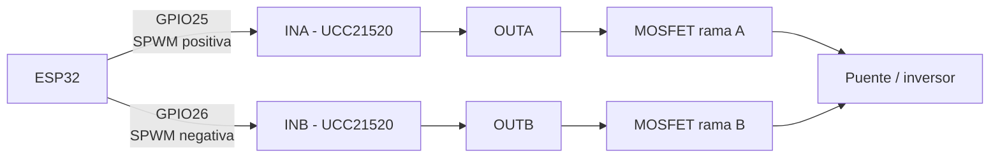

# Generador SPWM del inversor

Este sketch genera dos señales SPWM para las entradas `INA` e `INB` de un
driver UCC21520 conectado a un ESP32. La señal no alterna las dos salidas en
cada periodo de la portadora: primero entrega el semiciclo positivo completo y
después el semiciclo negativo completo.

## Conexion

| Senal | GPIO ESP32 | Funcion |
| --- | ---: | --- |
| `SPWM_POSITIVA` | 25 | Entrada `INA` del UCC21520 |
| `SPWM_NEGATIVA` | 26 | Entrada `INB` del UCC21520 |

Los GPIO se pueden cambiar al principio de `spwm.ino`:

```cpp
constexpr uint8_t PIN_SPWM_POSITIVA = 25;
constexpr uint8_t PIN_SPWM_NEGATIVA = 26;
```

Las salidas del ESP32 deben conectarse a las entradas logicas del driver, no a
las compuertas de los MOSFET directamente. La alimentacion, las masas y las
conexiones del UCC21520 deben respetar el esquema del inversor.

### Diagrama de conexion



Las etiquetas `positiva` y `negativa` describen el orden de la modulacion. No
significan que el GPIO del ESP32 entregue una tension negativa: ambos GPIO son
senales digitales PWM respecto a la masa del ESP32.

## Secuencia SPWM

El programa usa dos tablas de 200 valores:

- `lookUp1`: contiene el seno en las primeras 100 posiciones y ceros en las
	100 posiciones restantes.
- `lookUp2`: contiene ceros en las primeras 100 posiciones y el seno en las
	100 posiciones restantes.

En cada interrupcion se usa el mismo indice `phase` para actualizar ambas
salidas:

| Indices | `lookUp1` / salida positiva | `lookUp2` / salida negativa |
| --- | --- | --- |
| `0..99` | SPWM seno | 0 |
| `100..199` | 0 | SPWM seno |

Al llegar al indice 200, `phase` vuelve a cero. Por tanto, nunca se ordena
simultaneamente un duty distinto de cero para las dos entradas del driver.
El primer periodo empieza con la salida positiva y, despues de 100 pasos,
continua con la salida negativa.

### Secuencia temporal de un ciclo

```text
		   100 pasos                         100 pasos
	|<----------------------------->|<----------------------------->|
phase  0                              99 100                           199
	|                                |                                |
GPIO25 [ PWM con envolvente seno       ] [              0                ]
GPIO26 [              0                ] [ PWM con envolvente seno       ]
	+--------------------------------+--------------------------------+
			    ciclo completo = 20 ms
```

La envolvente seno no es un unico pulso largo: cada bloque contiene 100
periodos PWM de `10 kHz`. El duty de esos pulsos aumenta hasta el pico y luego
disminuye hasta cero.

### Forma conceptual en el osciloscopio

```text
GPIO25 / salida positiva
 duty       /\
	    /  \       PWM activo
	   /    \      durante 100 pasos
 ________/      \____________________________

GPIO26 / salida negativa
 ____________________/      \________________
			\    /
			 \  /       PWM activo
			  \/        durante 100 pasos
```

La figura representa la envolvente de los pulsos. Al ampliar cualquier zona
activa del osciloscopio se deben ver pulsos rectangulares de 10 kHz, no una
onda seno analogica.

## Frecuencias y escala

La portadora PWM funciona a `10 kHz`. El temporizador del ESP32 actualiza el
duty una vez por cada periodo de la portadora:

```text
Periodo de actualizacion = 1 / 10000 Hz = 100 us
Periodo completo         = 200 pasos x 100 us = 20 ms
Frecuencia fundamental    = 1 / 20 ms = 50 Hz
```

Las tablas conservan la escala del programa original, cuyo periodo PWM era
`ICR1 = 1600`. Como el ESP32 usa LEDC con 11 bits, su rango de duty es
`0..2047`. Antes de escribir el duty se hace esta conversion:

```text
duty_LEDC = valor_de_tabla x 2047 / 1600
```

Asi, el valor `1600` de la tabla sigue representando el 100 % del periodo,
aunque el hardware del ESP32 use una cuenta maxima de 2047.

## Temporizador

El temporizador se configura con una base de `1 MHz`, es decir, cada cuenta
equivale a `1 us`. La alarma se dispara cada `100 us` y ejecuta
`onSpwmTimer()`, que escribe los dos duty LEDC y avanza `phase`.

El sketch utiliza la API actual de Arduino-ESP32:

- `ledcAttach(pin, frecuencia, resolucion)` para configurar cada salida PWM.
- `ledcWrite(pin, duty)` para cambiar el duty.
- `timerBegin(1000000)`, `timerAttachInterrupt()` y `timerAlarm()` para el
	temporizador de actualizacion.

Se recomienda usar una version reciente del core Arduino-ESP32 compatible con
estas funciones.

## Verificacion con osciloscopio

Antes de conectar la etapa de potencia:

1. Alimentar solamente el ESP32 y la logica del driver.
2. Medir `GPIO25` y `GPIO26` con respecto a la masa logica del ESP32.
3. En `GPIO25` se deben observar aproximadamente 100 pulsos PWM modulados y
	 despues nivel bajo durante los siguientes 100 periodos.
4. En `GPIO26` debe ocurrir lo contrario: nivel bajo primero y despues los
	 100 pulsos modulados.
5. Comprobar que ambas salidas no tengan duty distinto de cero al mismo
	 tiempo y que el driver aporte el tiempo muerto requerido.

La forma observada en un ciclo completo debe repetirse cada aproximadamente
`20 ms`, mientras que los pulsos individuales deben estar separados por
`100 us`.

> No conectar las salidas del ESP32 directamente a los MOSFET. Verificar
> primero las senales logicas y luego las salidas aisladas del UCC21520 con una
> sonda adecuada para la tension de cada lado del puente.
